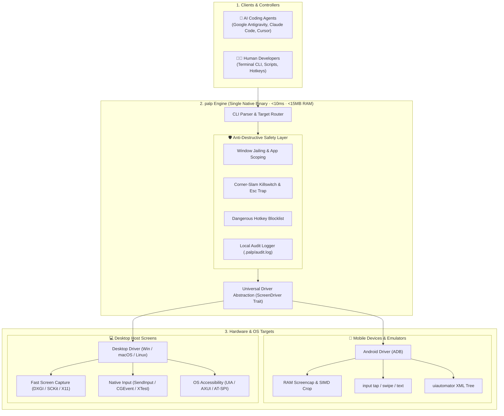

# 🏗️ Technical Architecture: Universal Screen Driver

`palp` provides AI coding assistants and human developers with a unified, high-speed, and safe interface to inspect and interact with mobile devices and desktop host screens.

This document outlines the internal architecture, driver abstraction, and platform backends.

---

## 📐 System Architecture Diagram



---

## 🔌 The `ScreenDriver` Trait

At the heart of `palp` is the `ScreenDriver` trait. It decouples high-level CLI commands (`palp snap`, `palp tap`, `palp type`) from target-specific transports:

```rust
pub trait ScreenDriver {
    /// Human-readable name of the target device or screen
    fn name(&self) -> &str;

    /// Probes physical screen resolution, DPI density, and system bar insets
    fn probe(&self) -> Result<DisplayMetrics, PalpError>;

    /// Captures a raw screenshot directly into host computer memory
    fn screencap_png(&self) -> Result<Vec<u8>, PalpError>;

    /// Taps/clicks at the given screen coordinates
    fn tap(&self, x: u32, y: u32) -> Result<(), PalpError>;

    /// Types text into the currently active input field
    fn input_text(&self, text: &str) -> Result<(), PalpError>;

    /// Sends a virtual or hardware key event
    fn keyevent(&self, key: &str) -> Result<(), PalpError>;

    /// Performs a swipe or drag gesture between two coordinates
    fn swipe(&self, x1: u32, y1: u32, x2: u32, y2: u32, duration_ms: u32) -> Result<(), PalpError>;
}
```

---

## 📱 Mobile Target (Android / ADB)

- **Transport**: Communicates with connected physical phones or emulators via the Android Debug Bridge (`adb`).
- **RAM Streaming**: Takes screenshots via `exec-out screencap -p` directly over standard output into RAM buffers.
- **Fail-Safe Animation Guard**: Automatically pauses Android animations (`animator_duration_scale = 0`) before dumping UI hierarchies to prevent UI Automator hangs, and uses a Rust **RAII Drop guard** to unconditionally restore original settings even if interrupted.
- **Hardware Agnostic**: Compatible with smartphones, foldables, tablets, Android TV, Wear OS smartwatches, and XR headsets (Meta Quest).

---

## 💻 Desktop Target (Windows, macOS, Linux)

- **Transport**: Native host operating system graphic and input APIs.
- **Screen Capture**:
  - **Windows**: DirectX Graphics Infrastructure (DXGI Desktop Duplication) or GDI `BitBlt`.
  - **macOS**: ScreenCaptureKit or Quartz Display Services (`CGDisplayCreateImage`).
  - **Linux**: X11 `XGetImage` or Wayland Desktop Portal (`org.freedesktop.portal.ScreenCast`).
- **Input Simulation**:
  - **Windows**: Win32 `SendInput` (`MOUSEEVENTF_LEFTDOWN`, `MOUSEEVENTF_LEFTUP`, `KEYEVENTF_UNICODE`).
  - **macOS**: CoreGraphics `CGEventCreateMouseEvent` and `CGEventPost`.
  - **Linux**: X11 `XTestFakeButtonEvent` / `XTestFakeKeyEvent` or `uinput`.
