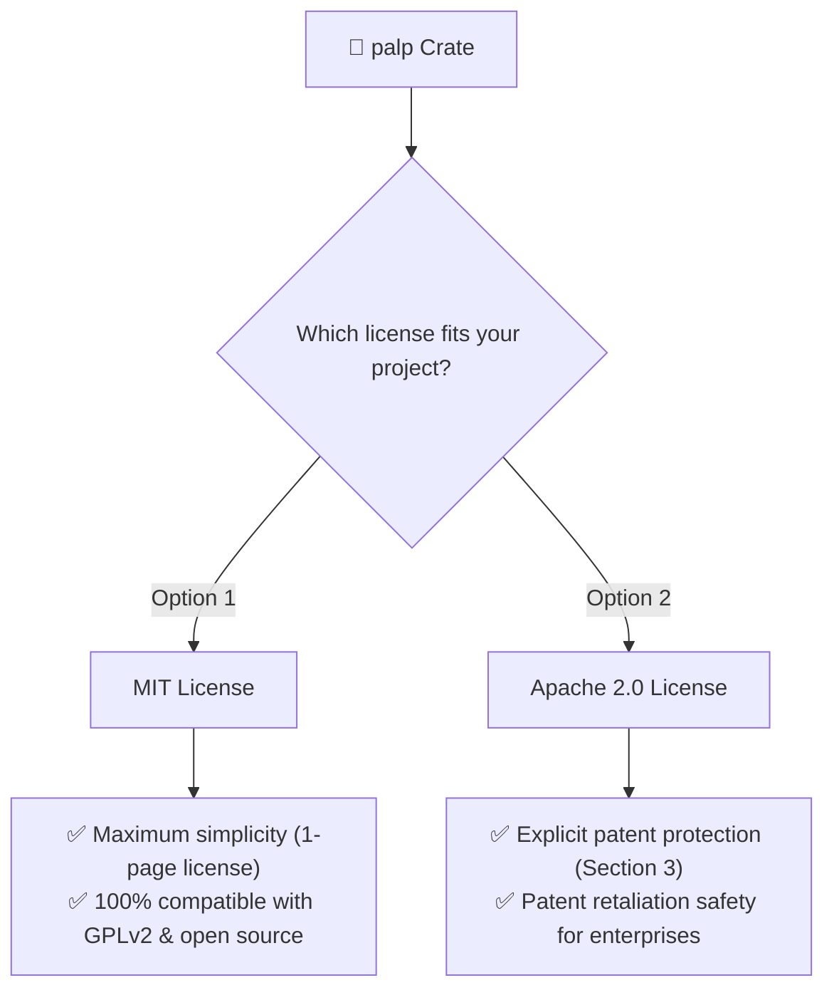

# 📄 Licensing Guide: Understanding `MIT OR Apache-2.0` in `palp`

`palp` is dual-licensed under both the **MIT License** and the **Apache License (Version 2.0)**.

```toml
# In Cargo.toml
license = "MIT OR Apache-2.0"
```

This guide explains in simple English why two licenses exist and how you can freely choose between them.

---

## 💡 What Does the Dual License Mean for You?

The word **`OR`** means **you get to choose whichever license fits your project best**. You do **not** have to comply with both licenses; simply pick the one that matches your needs.



---

## ❓ Why Does `palp` Have Two Licenses?

In languages like JavaScript (npm) or Python (PyPI), most packages use only `MIT`. However, in the **Rust ecosystem**, `MIT OR Apache-2.0` is the official standard recommended by the Rust Foundation (used by the Rust compiler itself, `tokio`, `serde`, `clap`, and `syn`).

Here is the practical dilemma it solves:

### 1. Why `MIT` Alone Isn't Always Enough
- The **MIT License** was written in 1988 and covers **copyright only**. It does not mention software patents.
- If an outside contributor holds patents on an algorithm they submit, users of an MIT-licensed library could theoretically face patent disputes.
- Many enterprise companies and corporate legal teams are cautious about using or contributing to pure MIT software without explicit patent clauses.

### 2. Why `Apache 2.0` Alone Isn't Always Enough
- The **Apache 2.0 License** provides ironclad patent grants (Section 3) and an automatic patent retaliation clause (if someone sues over patents, their license is revoked).
- However, the Free Software Foundation (FSF) ruled that Apache 2.0 is **incompatible with GPLv2** (General Public License version 2).
- If `palp` were Apache-2.0 only, developers building GPLv2-licensed software (such as Linux kernel tools or classic open-source applications) could not legally use or link `palp`.

### 3. The Rust Solution: `MIT OR Apache-2.0`
By offering both:
- **Open-source authors & GPLv2 projects** can use `palp` under the terms of the **[MIT License](../LICENSE-MIT)**.
- **Enterprise teams & corporate developers** can use `palp` under the terms of the **[Apache 2.0 License](../LICENSE-APACHE)** for complete patent indemnity.

---

## 📋 Quick Comparison

| Feature | MIT License | Apache 2.0 License |
| :--- | :---: | :---: |
| **Commercial Use** | ✅ Allowed | ✅ Allowed |
| **Modification & Distribution** | ✅ Allowed | ✅ Allowed |
| **Private Use** | ✅ Allowed | ✅ Allowed |
| **GPLv2 Compatibility** | ✅ Yes | ❌ No |
| **Explicit Patent Grant** | ❌ No | ✅ Yes (Section 3) |
| **Patent Retaliation Clause** | ❌ No | ✅ Yes |
| **Length & Complexity** | Very Short (1 page) | Comprehensive |

---

## 🤝 Contributing

Unless you explicitly state otherwise, any contribution intentionally submitted for inclusion in `palp` by you shall be dual-licensed as above, without any additional terms or conditions.
