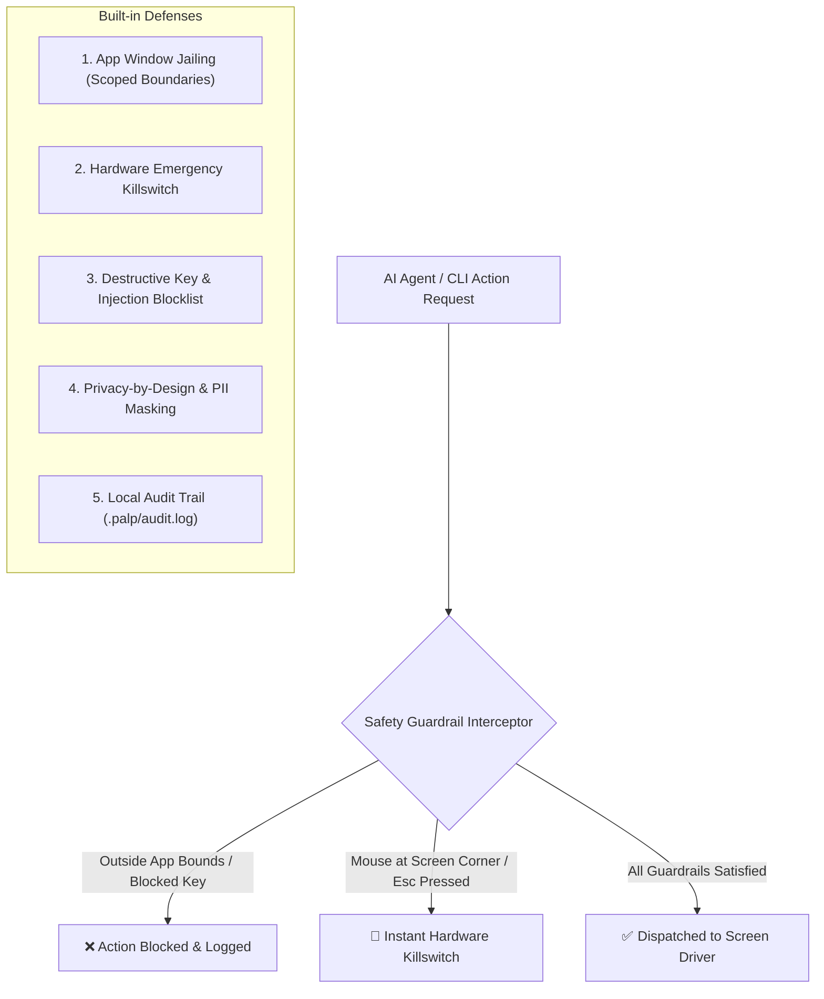

# 🛡️ Safety & Privacy: Anti-Destructive Architecture

When giving AI coding assistants (such as **Google Antigravity**, **Claude Code**, or **OpenAI Codex**) the ability to touch, tap, click, and view your mobile or desktop screens, **safety by design is paramount**.

Without strict guardrails, an autonomous agent could click outside your test app, send unwanted messages, format directories, or leak private notifications.

`palp` implements a **multi-layer defense architecture** to ensure AI agents remain helpful test drivers and never become destructive tools.

---

## 🏗️ Multi-Layer Protection Architecture

---

## 1. Application Window Jailing (Scoped Boundaries)

- **The Danger**: An AI agent asked to test a checkout button could accidentally click the system taskbar, launch your email client, or close your code editor.
- **How `palp` Protects You**:
  - **Desktop Scoping (`--app <name>` / `--scoped`)**: Constrains mouse clicks and keystrokes strictly inside the designated target window rectangle. If an agent tries to click outside the application boundary, `palp` immediately rejects the action with a `BoundsViolation` error.
  - **Mobile Foreground Scoping**: On mobile, commands are scoped to the foreground application package (e.g. `com.example.app`). If the operating system leaves the app, `palp` halts execution rather than tapping the user's home screen or phone settings.

---

## 2. Hardware Emergency Killswitch

- **The Danger**: An autonomous agent gets stuck in a rapid tapping loop and you need to stop it instantly.
- **How `palp` Protects You**:
  - **Corner Slam (Desktop)**: Moving your physical mouse cursor to any of the four corners of your screen `(0, 0)` immediately triggers an emergency fail-safe abort.
  - **Signal Trapping (`Ctrl+C` / `Esc`)**: Pressing `Ctrl+C` or `Esc` immediately cancels execution and unconditionally releases any held mouse buttons or modifier keys (`Shift`, `Ctrl`, `Alt`), preventing input lockups.

---

## 3. Destructive Key & Command Blocklist

- **The Danger**: An agent typing into a search box or terminal accidentally triggers destructive system commands.
- **How `palp` Protects You**:
  - **Blocked System Hotkeys**: `palp` refuses to execute destructive system shortcuts:
    - ❌ `Win+L` *(lock screen)*
    - ❌ `Ctrl+Alt+Del` *(system interrupt)*
    - ❌ `Alt+F4` *(force close application)*
    - ❌ `Win+X`, `Power`, `Sleep` keys
  - **Shell Sanitization**: Text input is strictly sanitized and escaped to prevent unintended shell execution (`rm -rf`, `format`, `del /s /q`).

---

## 4. Privacy-by-Design: 100% Offline & RAM-Only

- **Zero Cloud Calls**: `palp` has zero telemetry, zero analytics, and zero external network connections. Screen captures and device metrics **never leave your local computer**.
- **RAM-Only Processing**: Screen captures are streamed directly into system memory for cropping and analysis. No temporary image files are ever cached on your phone's SD card or computer's drive.
- **PII & Status Bar Cropping**: Personal notifications, battery levels, network indicators, and clock displays are sliced away in memory before screenshots are saved.
- **Password Redaction**: In UI accessibility tree dumps, any element flagged with `password="true"` or containing authentication credentials has its values masked with `••••••••`.

---

## 5. Local Audit Trail & Dry-Run Mode

- **Local Audit Log**: Every action an AI agent takes is appended to a local file (`.palp/audit.log`) with timestamps, target coordinates, element text, and outcomes. You can inspect exactly what the AI did at any time.
- **Dry-Run Mode (`--dry-run`)**: Run any command with `--dry-run` to inspect what `palp` *would* click or type without actuating physical hardware.
